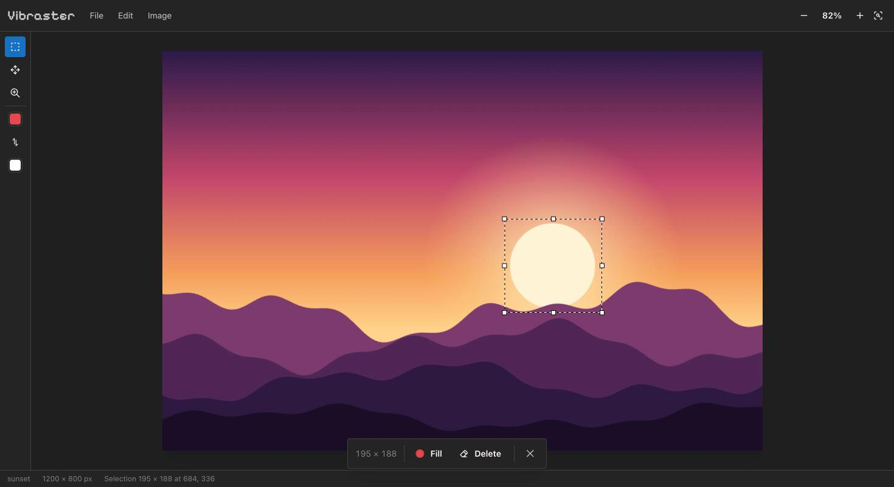

# Vibraster

A small in-browser raster image editor built with React and [Mantine](https://mantine.dev).



- Create a new image (size presets; any color or transparent)
- Open PNG, JPEG, WebP, GIF or BMP files (toolbar, drag and drop, or paste)
- Work on several images at once, each in its own tab
- Rectangle selection with resize handles (Shift keeps the aspect ratio): fill with a color picked in the action bar (swatches, hex or eyedropper), delete or move to transparency
- Move tool: drag to move pixels, drag handles to scale or flip them; flip or rotate them from the action bar
- Resize the image (scale) or the canvas (crop / extend, new area filled with a chosen color or transparent)
- Copy and paste through the system clipboard; pasted images land as movable pixels
- Undo / redo, zoom, save as PNG

## Shortcuts

| Key                        | Action                                       |
| -------------------------- | -------------------------------------------- |
| M / V / Z                  | Select / Move (with a selection) / Zoom tool |
| Click, ⌥-click (Zoom tool) | Zoom in / out at that point                  |
| F                          | Fill selection                               |
| Delete, ⌫                  | Delete selection                             |
| Esc, ⌘D                    | Deselect                                     |
| ⌘A, double-click image     | Select all                                   |
| ⌘Z / ⇧⌘Z, ⌘Y               | Undo / redo                                  |
| ⌘C / ⌘V                    | Copy / paste (as movable pixels)             |
| ⌘+ / ⌘− / ⌘0               | Zoom in / out / fit                          |
| ⌘O / ⌘S                    | Open / save PNG                              |

## Development

```sh
vp install
vp dev
vp check
```
